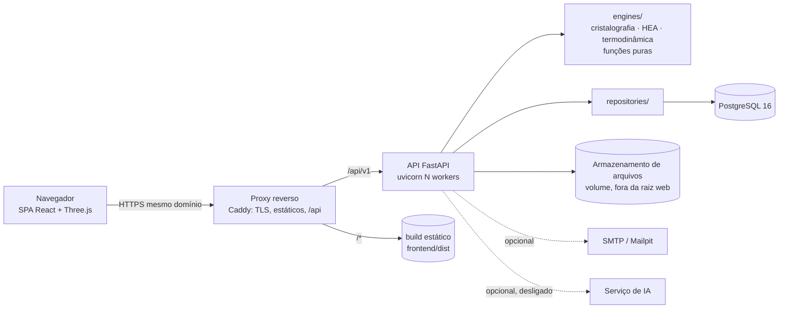
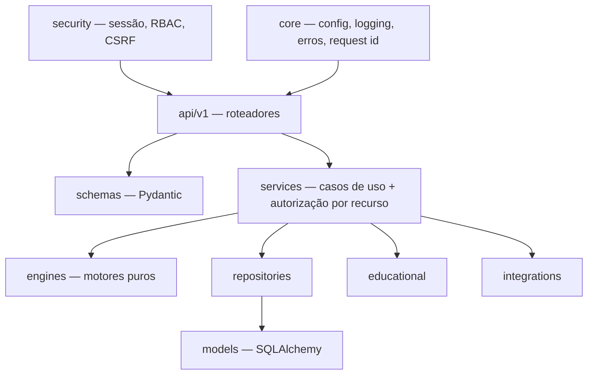
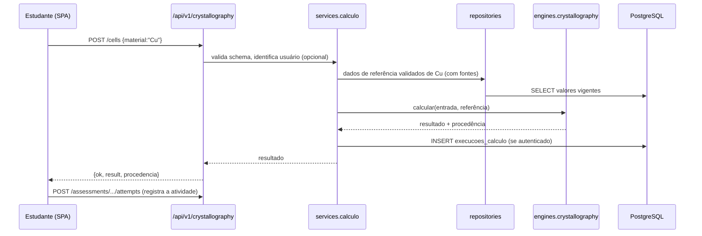

# Arquitetura Final — Alloy Virtual Lab

| Item | Valor |
|---|---|
| Versão | 1.0 — Fase 2 (Gate 1) |
| Data | 02/11/2026 |
| Requisitos atendidos | RQ-ARQ-01..05 e as bases de RQ-DAD, RQ-API, RQ-SEG e RQ-FE ([REQUISITOS_BASE.md](REQUISITOS_BASE.md)) |
| Decisões detalhadas | [DECISOES_TECNICAS.md](DECISOES_TECNICAS.md) (ADR-001..017) |
| Modelo de dados | [BANCO_DE_DADOS.md](BANCO_DE_DADOS.md) |
| Contratos | [API.md](API.md) |
| Estado | **Proposta para aprovação do Gate 1**. Nada aqui está implementado ainda. |

## 1. Visão geral

Uma aplicação web única, servida no **mesmo domínio**:

- **SPA** React/TypeScript (base C) para estudantes, professores e administradores.
- **API** FastAPI (base B), que é a única porta de entrada para dados e cálculos.
- **Motores científicos puros** dentro do processo da API: cristalografia, HEA e termodinâmica.
- **PostgreSQL** como fonte única de verdade, com migrações Alembic.
- **Armazenamento de arquivos** para tutoriais e anexos, com metadados no banco.



**Por que mesmo domínio:** permite usar cookie de sessão `SameSite` sem CORS em produção, uma CSP simples e um só certificado (ADR-008 e ADR-011).

## 2. Backend em camadas



**Regras de dependência** (viram teste automatizado `test_arquitetura.py` na Fase 3):

| Camada | Pode importar | Não pode importar |
|---|---|---|
| `api` | schemas, services, security, core | models, repositories, engines (diretamente) |
| `services` | engines, repositories, educational, integrations, schemas, core | api |
| `engines` | só a biblioteca padrão e outros `engines` | **tudo** do app (sem I/O, sem banco, sem FastAPI) |
| `repositories` | models, core | services, api, engines |
| `models` | core | todo o resto |

**Consequência central (PI-03):** existe **uma** implementação de cada fórmula, dentro de `engines/`. A API, a exportação, os exercícios paramétricos e o viewer consomem a mesma função.

### 2.1 Motores científicos

| Motor | Conteúdo | Origem | Classe dos resultados |
|---|---|---|---|
| `engines/crystallography` | Estruturas, rede (medida ou derivada), FEA, densidade, Miller/Bravais, planar, supercélula, famílias de planos, CIF/XYZ, ligas (Vegard, Hume-Rothery), intersticiais | B `core/` + recursos da A refeitos com testes | analítico (cálculo determinístico sobre dados com procedência) |
| `engines/thermodynamics` | Dilatação linear, Lindemann, alotropia; diagrama de fases conforme a especificação A/docs/2 | A v1.4 | estimativa de modelo (aproximações declaradas) |
| `engines/hea` | ΔS_mix ideal, T_m média, VEC, δ (analíticos com dados de elemento com fonte); ΔH_mix e Ω só com tabela de pares com fonte (Q-01) | novo | analítico ou estimativa de modelo; nunca demonstrativo em produção |
| `engines/machine_learning` | vazio | — | — |

Contrato comum dos motores:

```python
def calcular(entrada: EntradaTipada, referencia: DadosReferencia) -> ResultadoComProcedencia: ...
```

- `DadosReferencia` é **injetado pelo serviço** (vem do repositório). O motor nunca lê arquivo nem banco.
- Todo resultado carrega o bloco `procedencia` (seção 6).

## 3. Frontend

Base C, migrada na Fase 5 (ADR-010).

| Módulo (`frontend/src/modules`) | Responsabilidade | Situação de partida |
|---|---|---|
| `app/` + `design-system/` | Shell, rotas, tema, i18n, componentes | C (pronto) |
| `crystalab/` | Laboratório de células, Miller, viewer, exportação | C + telas da A (ligas, temperatura, prática) |
| `hea/` | Composição, predição, histórico, comparação | C (só demonstrativo) → real |
| `didactics/` | Conteúdos, exercícios, quizzes, ABP | C (local) → servidor |
| `assessments/` | **novo**: tentativas, correção, gabarito com política | especificação A/docs/3 |
| `instructor/` | Turmas, atribuições, relatórios | C (rascunho local) → servidor |
| `notebook/` | Caderno com captura de cena | C (local) → servidor com cache offline |
| `administration/` | **novo**: usuários, instituições, validação científica | — |
| `library/` | **novo**: tutoriais e materiais compartilhados | A (biblioteca) |

Regras:

- Toda E/S passa por `services/api/http.ts`. A regra R1 do lint do C continua valendo.
- **Nenhum cálculo científico** em componentes. O viewer desenha a geometria devolvida pela API, incluindo supercélulas (fecha D-10/D-11).
- O estado `live | demo | disabled` de cada serviço vem de `GET /api/v1/meta/capabilities`. Em produção o servidor responde `demo_permitido: false`, e o frontend não pode ativar demonstração (ADR-016).
- Os tipos de contrato são gerados do OpenAPI. Os schemas Zod continuam como validação em tempo de execução (ADR-007).

## 4. Domínios (contextos)

| Domínio | Dono no backend | Entidades principais | Rotas |
|---|---|---|---|
| Identidade e acesso | `security/`, `services/identidade` | usuários, sessões, tokens, consentimentos | `/auth`, `/users` |
| Organização acadêmica | `services/academico` | instituições, cursos, turmas, matrículas | `/institutions`, `/classes` |
| Ciência — cálculo | `engines/*`, `services/calculo` | execuções de cálculo | `/crystallography`, `/hea`, `/thermodynamics`, `/exports` |
| Ciência — dados | `services/materiais` | elementos, materiais, composições, propriedades, fontes, validação | `/elements`, `/materials`, `/alloys`, `/properties`, `/sources` |
| Educacional | `educational/` | atividades, questões, instâncias, tentativas, notas, caderno | `/activities`, `/assessments`, `/progress`, `/notebook` |
| Professor | `educational/` + relatórios | atribuições, entregas, relatórios | `/instructor`, `/reports` |
| Arquivos | `services/arquivos` | arquivos e tutoriais | `/files` |
| Plataforma | `core/` | capacidades, saúde, auditoria | `/meta`, `/health` |
| IA | `integrations/ia` | — (desligado) | `/ai` |

## 5. Fluxos de aceitação na arquitetura

### Fluxo A — CrystaLab



- **Fluxo B — HEA:** composição → `services.hea` valida (soma 100% ± tolerância, elementos com dados) → `engines.hea` calcula só o que tem fonte → `execucoes_calculo` → resposta com campos `indisponivel` explícitos para o que falta (Q-01).
- **Fluxo C — Professor:** `POST /activities` → `POST /instructor/assignments` (turma + materiais) → estudante resolve `/assessments` → tentativas persistidas → `GET /reports/classes/{id}`.
- **Fluxo D — Banco de materiais:** `POST /materials` (estado `rascunho`) → `POST /materials/{id}/submit` → validador `POST .../review` (`validado` ou `rejeitado`) → visível conforme o escopo.
- **Fluxo E — Aprendizagem:** tentativa → `educational` classifica o tipo de erro (regras determinísticas: unidade, fator 10ⁿ, sinal, índice oposto) → progresso → recomendação por regra registrada.

## 6. Procedência e classificação dos resultados (PI-06, PI-07)

Todo resultado científico devolvido pela API inclui:

```json
"procedencia": {
  "classe": "analitico | estimativa_modelo | experimental | simulacao_ilustrativa | demonstrativo",
  "motor": "crystallography",
  "versao_motor": "2.0.0",
  "versao_dados": "2026.11.1",
  "fontes": [{"id": "callister-10ed", "citacao": "...", "campos": ["raio_nm", "peso_g_mol"]}],
  "parametros_sha256": "…",
  "calculado_em": "2026-11-02T20:00:00Z",
  "avisos": ["…"]
}
```

- `demonstrativo` só existe com `ALLOY_DEMO=permitido` (dev ou teste). Em produção a API recusa gerar esse tipo de resultado.
- Um valor de referência **sem fonte** não alimenta o motor em produção. Ele aparece como "a validar" e o cálculo informa o campo ausente.

## 7. Segurança (resumo; detalhes no ADR-008/009 e em [SEGURANCA.md](SEGURANCA.md))

- **Sessão:** token opaco de 256 bits em cookie `HttpOnly; Secure; SameSite=Lax; Path=/api`. O banco guarda só o hash SHA-256. Expira por inatividade e por tempo máximo, e pode ser revogada.
- **CSRF:** toda escrita exige o cabeçalho `X-Alloy-CSRF` com o token de sessão CSRF. O `SameSite=Lax` é a segunda barreira (mesmo padrão de cabeçalho já usado na A).
- **Senhas:** Argon2id. Verificação de e-mail e redefinição de senha por tokens de uso único com hash e expiração.
- **Autorização:** `services` resolve o **escopo** (global → instituição → turma → dono) antes de qualquer leitura ou escrita. Esconder botão no frontend não é controle.
- **Isolamento:** toda consulta acadêmica filtra por `instituicao_id`. Row-Level Security no PostgreSQL fica como defesa em profundidade, avaliada na Fase 8.
- **Entrada e saída:** Pydantic com limites; corpo máximo, CSP e cabeçalhos (middlewares do B); uploads em lista branca, fora da raiz web, servidos com `Content-Disposition` e `nosniff`.
- **Rate limit:** ligado por padrão fora de dev, mais restrito em `/auth`.

## 8. Ambientes e configuração

| Variável | dev | teste | produção |
|---|---|---|---|
| `ALLOY_ENV` | `dev` | `test` | `prod` |
| `DATABASE_URL` | Postgres local ou do compose | Postgres efêmero do CI | segredo do servidor |
| `ALLOY_DEMO` | `permitido` | `permitido` | `proibido` (forçado) |
| `ALLOY_DOCS` | ligado | ligado | desligado (ou protegido) |
| `SESSION_SECRET` / `CSRF_SECRET` | gerado | fixo de teste | segredo |
| `SMTP_URL` | Mailpit | captura em memória | provedor real (Q-04) |
| `RATE_LIMIT` | desligado | ligado (baixo) | ligado |
| `STORAGE_DIR` | `./var/arquivos` | temporário | volume persistente |
| `IA_ENABLED` | falso | falso | falso até decisão |

Os segredos ficam só em variáveis de ambiente. `.env.example` sem valores reais (RQ-SEG-06).

## 9. Observabilidade

- Cada requisição recebe `X-Request-ID` (gerado ou propagado). Ele vai na resposta, nos logs e na tabela `auditoria`.
- Logs estruturados em JSON (nível, rota, status, duração, request_id, usuário pseudonimizado), sem corpo de requisição nem segredo.
- Health checks `/health/live` e `/health/ready`; o ready verifica banco, migração aplicada, armazenamento e versão dos dados.
- Métricas mínimas: latência p50/p95 por rota, contagem de erros e duração dos cálculos.

## 10. Desempenho e evolução

- Os cálculos são síncronos e rápidos. Medição do motor B nesta máquina (200 chamadas × 5 repetições): célula Cu 0,32 ms, célula Mg 0,38 ms, Miller HC (10-11) 0,24 ms e CIF 0,94 ms de mediana, com máximo de 1,09 ms. Os handlers usam `def`, que roda no threadpool (padrão do B).
- **Filas e Redis só por evidência** (ADR-012): adotar quando o p95 de uma rota passar de 2 s ou uma tarefa passar de 10 s (relatórios grandes, lotes, ML).
- Cache: as tabelas de referência levam `Cache-Control` público (como no B), e os cálculos podem ser memorizados por `parametros_sha256`.

## 11. Mapeamento origem → destino

| Origem | Destino | Ação |
|---|---|---|
| B `core/*.py` | `backend/app/engines/crystallography/` | Mover; manter API pública e testes |
| B `api/*.py` | `backend/app/api/v1/`, `core/`, `security/` | Mover; rotas passam para `/api/v1` (alias `/v1` transitório) |
| B `core/dados/metais.json` | `database/seeds/` | Vira seed; cada valor ganha fonte |
| B `tests/` | `backend/tests/unit`, `integration` | Mover |
| A ligas, temperatura, planar, supercélula, passos | `engines/crystallography`, `engines/thermodynamics` | Reescrever com testes de referência primeiro |
| A tutoriais | `services/arquivos` + rotas `/files` | Reescrever com auth |
| A `docs/1..3` | `educational/` e `services/preferencias` | Implementar nas Fases 3 e 7 |
| C inteiro | `frontend/` | Mover; remover `vendor/`, `engine-stub/`, `legacy/`; portabilidade |
| D | — | Não migra (ancestral, já coberto por A e B) |

## 12. Checklist do Gate 1 (Agente 05 §5)

| Verificação | Resposta |
|---|---|
| A. Requisitos | ARQ-01..05 endereçados; demais domínios com dono e rota |
| B. Fronteiras | Camadas e regras de dependência definidas e testáveis |
| C. Correção | Motor único; regra de rede medida adotada (corrige CIE-01) |
| D. Segurança | Sessão, CSRF, RBAC por escopo, isolamento por instituição |
| E. Dados | Procedência, classes, versionamento e estados de validação modelados |
| F. Integração | Envelope atual mantido; OpenAPI → tipos; capacidades |
| G. UX | Módulos novos previstos (assessments, administration, library) |
| H–I. Testes e desempenho | Estratégia por camada; critérios objetivos para filas |
| J. Documentação | Este documento + ADRs + banco + API |
| K. Regressão | Contratos atuais preservados via alias `/v1` e envelope |

**Pendências que não bloqueiam o Gate 1:** Q-01 (HEA), Q-02 (hospedagem), Q-03 (validador científico), Q-04 (e-mail).
