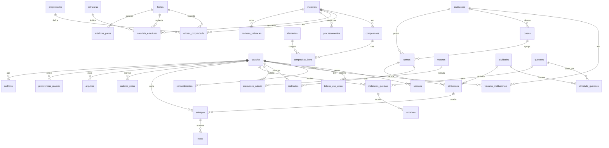

# Banco de Dados — modelo lógico (Fase 2)

| Item | Valor |
|---|---|
| SGBD | PostgreSQL 16 (ADR-003) |
| ORM e migrações | SQLAlchemy 2.x + Alembic |
| Responsável | Agente 02 |
| Requisitos | RQ-DAD-01..08, RQ-SEG-03/04/07, RQ-EDU-01..06, RQ-HEA-03/05 |
| Estado | **Proposta para o Gate 1**. As migrações são escritas na Fase 3. |

## 1. Convenções

| Regra | Valor |
|---|---|
| Chave primária | `id uuid DEFAULT gen_random_uuid()`. Exceções: catálogos com chave natural estável (`elementos.simbolo`, `propriedades.codigo`, `estruturas.codigo`) |
| Datas | `timestamptz`, sempre em UTC; exibição no fuso do usuário |
| Números científicos | `numeric` (decimal exato, sem perda na ida e volta), convertido para float só dentro do motor |
| Unidade | Coluna explícita ou catálogo (`propriedades.unidade_si`). **Nunca** valor sem unidade |
| Texto controlado | `text` + `CHECK (col IN (...))`. Enums do PostgreSQL ficam para domínios realmente fixos |
| JSONB | Só para dados heterogêneos com contrato próprio (parâmetros e resultados de motor, condições experimentais, definição de questão). Nunca para relações |
| Nomes | Português, `snake_case`, tabelas no plural |
| Auditoria de linha | `criado_em`, `criado_por`, `atualizado_em` onde há edição |
| Exclusão | Dados acadêmicos e científicos: arquivamento (`arquivado_em`). Dados pessoais: exclusão real ou anonimização sob pedido LGPD |

## 2. Diagrama ER

## 3. Dicionário de dados

### 3.1 Identidade e acesso

**usuarios**

| Coluna | Tipo | Nulo | Regra |
|---|---|---|---|
| id | uuid | não | PK |
| nome | text | não | 1–120 caracteres |
| email | citext | não | UNIQUE; normalizado em minúsculas |
| senha_hash | text | sim | Argon2id; nulo só para contas apenas SSO |
| email_verificado_em | timestamptz | sim | login liberado só depois de verificado |
| admin_geral | boolean | não | padrão `false`; único papel global (ADR-009) |
| status | text | não | `ativo`, `bloqueado`, `pendente`, `anonimizado` |
| ultimo_acesso_em | timestamptz | sim | |
| criado_em | timestamptz | não | |

**sessoes**: `id`, `usuario_id` FK, `token_sha256` bytea UNIQUE, `csrf_sha256` bytea, `criada_em`, `ultimo_uso_em`, `expira_em`, `revogada_em`, `ip_criacao` inet (retenção 90 dias), `agente_usuario` text curto. Índice em (`usuario_id`, `revogada_em`).

**tokens_uso_unico**: `id`, `usuario_id`, `finalidade` CHECK (`verificar_email`, `redefinir_senha`), `token_sha256` UNIQUE, `expira_em`, `usado_em`.

**consentimentos** (LGPD): `id`, `usuario_id`, `finalidade` (ex.: `historico_aprendizagem`, `pesquisa_anonimizada`), `versao_texto`, `concedido_em`, `revogado_em`.

**instituicoes**: `id`, `nome`, `sigla`, `configuracoes` jsonb (contrato: limites, cota de arquivos, permitir_cadastro), `criado_em`, `arquivado_em`.

**vinculos_institucionais**: `id`, `usuario_id`, `instituicao_id`, `papel` CHECK (`admin_institucional`, `professor`, `estudante`, `pesquisador`). UNIQUE (`usuario_id`, `instituicao_id`, `papel`).

**cursos**: `id`, `instituicao_id`, `nome`, `codigo`. UNIQUE (`instituicao_id`, `codigo`).

**turmas**: `id`, `instituicao_id` (desnormalizado de propósito, para filtro de isolamento), `curso_id` nulo, `disciplina`, `periodo` (ex.: `2026.2`), `professor_responsavel_id`, `codigo_convite` UNIQUE nulo, `arquivada_em`. CHECK: o professor responsável tem vínculo `professor` na mesma instituição (gatilho).

**matriculas**: `id`, `turma_id`, `usuario_id`, `papel_turma` CHECK (`estudante`, `monitor`, `professor_assistente`), `status` (`ativa`, `trancada`, `concluida`), `criado_em`. UNIQUE (`turma_id`, `usuario_id`).

### 3.2 Ciência — referência e repositório aberto

**fontes**

| Coluna | Tipo | Nulo | Regra |
|---|---|---|---|
| id | text | não | PK legível (ex.: `callister-10ed`, `crc-104`) |
| tipo | text | não | `livro`, `artigo`, `norma`, `base_dados`, `relatorio`, `outro` |
| citacao | text | não | ABNT ou APA completa |
| doi | text | sim | formato DOI validado |
| url | text | sim | |
| edicao_pagina | text | sim | **obrigatório para `livro`** (corrige CR-10) |
| licenca | text | sim | obrigatório antes de publicar dado importado |
| conferida_por | uuid | sim | validador humano (Q-03) |
| conferida_em | timestamptz | sim | |

**elementos**: `simbolo` PK (`^[A-Z][a-z]?$`), `nome`, `numero_atomico` UNIQUE. As propriedades (raio, massa, eletronegatividade, valência, T_f, α) **não** são colunas: ficam em `valores_propriedade` do material "elemento puro", com fonte.

**materiais**

| Coluna | Tipo | Nulo | Regra |
|---|---|---|---|
| id | uuid | não | PK |
| tipo | text | não | `elemento_puro`, `liga`, `hea`, `composto` |
| nome | text | não | |
| elemento_simbolo | text | sim | FK `elementos`; obrigatório se `tipo = elemento_puro` (CHECK) |
| estado | text | não | `rascunho`, `aguardando_validacao`, `validado`, `rejeitado`, `arquivado` |
| visibilidade | text | não | `publico`, `instituicao`, `privado` |
| instituicao_id | uuid | sim | obrigatório se visibilidade ≠ `publico` |
| origem | text | não | `curado`, `contribuicao`, `demonstrativo` (este nunca em produção, ADR-016) |
| criado_por | uuid | não | FK `usuarios` |
| criado_em, atualizado_em | timestamptz | não | |

**composicoes**: `id`, `material_id`, `versao` int, `base` CHECK (`atomica`, `massa`), `tolerancia_soma` numeric (padrão 0,001), `vigente` bool. UNIQUE (`material_id`, `versao`); índice parcial único de `vigente` por material.

**composicao_itens**: `composicao_id`, `elemento_simbolo`, `fracao` numeric CHECK (0 < fracao ≤ 1). PK composta. A soma igual a 1 ± tolerância é verificada por gatilho `DEFERRABLE` ao fim da transação.

**propriedades** (catálogo): `codigo` PK (`raio_atomico`, `massa_atomica`, `densidade`, `parametro_rede_a`, `parametro_rede_c`, `eletronegatividade`, `valencia`, `temperatura_fusao`, `coef_dilatacao_linear`, `entalpia_fusao`, `dureza`, `limite_escoamento`, …), `nome`, `grupo` (`fisica`, `mecanica`, `termica`, `cristalografica`), `unidade_si`, `unidade_exibicao`.

**valores_propriedade** (append-only, ADR-014)

| Coluna | Tipo | Nulo | Regra |
|---|---|---|---|
| id | uuid | não | PK |
| material_id | uuid | não | FK |
| propriedade_codigo | text | não | FK `propriedades` |
| valor | numeric | não | na unidade declarada |
| incerteza | numeric | sim | mesma unidade |
| unidade | text | não | conversível para `propriedades.unidade_si` (validado no serviço) |
| classe | text | não | `medido`, `calculado`, `estimado`, `importado`, `demonstrativo` |
| condicoes | jsonb | sim | contrato: `{temperatura_k, pressao_pa, fase, tratamento, metodo}` |
| fonte_id | text | sim | FK `fontes`; **obrigatória para `estado = validado`** (CHECK) |
| estado | text | não | mesmo domínio de `materiais.estado` |
| substitui_id | uuid | sim | FK para a versão anterior |
| vigente | boolean | não | índice parcial único (material, propriedade, condições normalizadas) WHERE vigente |
| criado_por, criado_em | | não | |

**estruturas** (catálogo): `codigo` PK (`CS`, `CCC`, `CFC`, `HC`), `nome`, `grupo_espacial_hm`, `grupo_espacial_numero`, `wyckoff`, `n`, `nc`. Seed vindo de B `estruturas.py`.

**materiais_estruturas**: `id`, `material_id`, `estrutura_codigo`, `fase` (ex.: `α`, `γ`), `temperatura_min_k`, `temperatura_max_k`, `a_nm`, `c_nm`, `fonte_id`, `estado`. Substitui `ALOTROPIA` e o *a* medido da A (ADR-005).

**processamentos**: `id`, `material_id`, `descricao`, `tratamento_termico` jsonb (`{etapas:[{temperatura_k, tempo_s, meio}]}`), `fonte_id`.

**revisoes_validacao**: `id`, `entidade` (`material`, `valor_propriedade`, `material_estrutura`), `entidade_id`, `de_estado`, `para_estado`, `revisor_id`, `comentario`, `criado_em`. Só papéis com permissão `validar_dados` mudam para `validado` (PI-05).

**entalpias_pares** (HEA, ADR-013): `elemento_a`, `elemento_b` (CHECK `elemento_a < elemento_b`), `dh_mix_kj_mol` numeric, `modelo` (ex.: `Miedema`), `fonte_id` NÃO nulo. PK (`elemento_a`, `elemento_b`, `fonte_id`).

### 3.3 Cálculos

**motores**: `codigo` (`crystallography`, `thermodynamics`, `hea`), `versao`, `descricao`, `classe_padrao`, `ativo`. PK (`codigo`, `versao`).

**execucoes_calculo**

| Coluna | Tipo | Nulo | Regra |
|---|---|---|---|
| id | uuid | não | PK |
| usuario_id | uuid | sim | nulo para cálculos anônimos não persistidos em histórico pessoal |
| instituicao_id | uuid | sim | escopo de relatório |
| motor_codigo, motor_versao | text | não | FK `motores` |
| versao_dados | text | não | seed/dados usados |
| operacao | text | não | ex.: `celula`, `miller`, `liga`, `hea_predicao` |
| parametros | jsonb | não | entrada normalizada |
| parametros_sha256 | bytea | não | índice para cache e deduplicação |
| resultado | jsonb | sim | saída completa com `procedencia` |
| classe_resultado | text | não | `analitico`, `estimativa_modelo`, `experimental`, `simulacao_ilustrativa`, `demonstrativo` |
| status | text | não | `pendente`, `em_execucao`, `concluido`, `falhou` (ADR-012) |
| erro | text | sim | mensagem sem dados sensíveis |
| duracao_ms | numeric | sim | |
| material_id | uuid | sim | FK opcional |
| criado_em | timestamptz | não | índice (`usuario_id`, `criado_em DESC`) para o histórico |

### 3.4 Educacional e professor

**atividades**: `id`, `instituicao_id`, `autor_id`, `titulo`, `tipo` (`exercicio`, `abp`, `quiz`, `simulacao`), `descricao` (texto com marcação restrita), `materiais_ids` uuid[] (dados escolhidos pelo professor, §11.3), `estado` (`rascunho`, `publicada`, `arquivada`), `versao`.

**questoes**: `id`, `instituicao_id` nulo (nulo = banco público), `autor_id`, `versao`, `tipo` (`numerico`, `multipla_escolha`, `verdadeiro_falso`, `miller`, `texto_curto`, `tabela_numerica`), `titulo`, `enunciado`, `pergunta_publica` jsonb, `gabarito` jsonb (**nunca serializado para estudante**), `parametros` jsonb, `politica` jsonb, `resolucao` jsonb, `dicas` jsonb, `topicos` text[], `dificuldade` 1–5, `publicada` bool. Contrato dos campos JSON: especificação A/docs/3 §4.

**atividade_questoes**: `atividade_id`, `questao_id`, `ordem`, `peso`. PK composta.

**atribuicoes**: `id`, `atividade_id`, `turma_id`, `abre_em`, `fecha_em`, `criterios` jsonb (`{nota_maxima, tentativas_maximas, politica_gabarito}`), `criado_por`.

**instancias_questao**: `id`, `questao_id`, `questao_versao`, `usuario_id`, `atribuicao_id` nulo (nulo = prática livre), `semente` bigint, `parametros_sorteados` jsonb, `gabarito_calculado` jsonb (restrito), `versao_motor`, `criado_em`. UNIQUE (`questao_id`, `usuario_id`, `atribuicao_id`, `semente`).

**tentativas**: `id`, `instancia_id`, `n` int, `resposta` jsonb, `resposta_normalizada` jsonb, `correta` bool, `pontuacao` numeric, `tipo_erro` (`unidade`, `fator_10n`, `sinal`, `indice_oposto`, `conceitual`, `nao_classificado`), `tempo_ms` (≤ 3 600 000), `dicas_usadas`, `gabarito_visto`, `criado_em`. UNIQUE (`instancia_id`, `n`), que dá idempotência.

**entregas**: `id`, `atribuicao_id`, `usuario_id`, `status` (`em_andamento`, `entregue`, `avaliada`), `entregue_em`. UNIQUE (`atribuicao_id`, `usuario_id`).

**notas**: `id`, `entrega_id`, `valor` numeric, `lancada_por`, `lancada_em`, `comentario`, `substitui_id` (histórico de revisão de nota).

**caderno_notas**: `id`, `usuario_id`, `titulo`, `conteudo` (texto com marcação restrita), `cena` jsonb (estado do viewer capturado), `atualizado_em`, `versao` (controle otimista para sincronizar o modo offline do C).

**preferencias_usuario**: `usuario_id` PK, `tema`, `idioma`, `cores_elementos` jsonb (`{"Fe": "#e06633"}`), `atualizado_em`. Atende A/docs/1.

**progresso** (VIEW materializada, atualizada após tentativas): por usuário e tópico, tentativas, acertos, taxa, última atividade e caixa de repetição espaçada.

### 3.5 Arquivos e auditoria

**arquivos**: `id`, `sha256` bytea, `nome_original`, `tipo_mime`, `extensao` CHECK na lista branca, `tamanho_bytes`, `categoria` (`tutorial`, `anexo_atividade`, `anexo_nota`), `dono_id`, `instituicao_id`, `visibilidade`, `criado_em`, `arquivado_em`. Índice em (`instituicao_id`, `categoria`).

**auditoria** (append-only; sem UPDATE e sem DELETE pelo usuário da aplicação): `id` bigserial, `ator_id`, `acao` (ex.: `material.validar`, `nota.lancar`, `usuario.anonimizar`), `entidade`, `entidade_id`, `antes` jsonb, `depois` jsonb (sem segredos), `request_id`, `ip` inet, `criado_em`. Particionada por mês quando o volume justificar.

## 4. Índices iniciais (justificados por consulta)

| Índice | Consulta que o justifica |
|---|---|
| `materiais (estado, visibilidade, tipo)` | Catálogo público de materiais validados |
| `valores_propriedade (material_id, propriedade_codigo) WHERE vigente` | Carregar referência para o motor |
| `execucoes_calculo (usuario_id, criado_em DESC)` | Histórico de predições do usuário |
| `execucoes_calculo (parametros_sha256)` | Cache e deduplicação |
| `matriculas (usuario_id)` | "Minhas turmas" |
| `tentativas (instancia_id, n)` UNIQUE | Idempotência e relatório da questão |
| `entregas (atribuicao_id, status)` | Painel do professor |
| `sessoes (token_sha256)` UNIQUE | Autenticação a cada requisição |

Cada índice é medido com `EXPLAIN ANALYZE` sobre um seed de carga na Fase 9. Índice sem consulta que o use é removido.

## 5. Integridade e concorrência

- **FKs** com `ON DELETE RESTRICT` por padrão. `CASCADE` só em dependentes puros (`sessoes`, `tokens_uso_unico` → `usuarios`).
- **Transações** abertas em `services`. Isolamento `READ COMMITTED`, com `SELECT … FOR UPDATE` em lançamento de nota e mudança de estado de validação.
- **Controle otimista** (`versao`) em `atividades`, `questoes` e `caderno_notas`. Conflito → HTTP 409.
- **Isolamento institucional:** toda consulta acadêmica recebe `instituicao_id` do escopo autorizado. Row-Level Security do PostgreSQL será avaliada como segunda barreira na Fase 8.

## 6. Seeds e migração dos dados existentes

| Origem | Destino | Regra |
|---|---|---|
| B `core/dados/metais.json` (15 metais, `versao_dados 2026.10.1`) | `elementos`, `materiais` (`elemento_puro`), `valores_propriedade`, `materiais_estruturas`, `fontes` | Raio, massa e densidade com fonte `callister` entram como `aguardando_validacao` até edição e página serem registradas (CR-10). *a* e *c* do Ti com a fonte indicada pelo B |
| B `estruturas.py` | `estruturas` | Direto (dados de cristalografia padrão) |
| A `PROPRIEDADES_EXTRAS` (α, T_f, χ, valência, *a* medido, cor) | `valores_propriedade` (`rascunho`, sem fonte) e `preferencias_usuario` padrão (cores Jmol) | **Não alimentam o motor em produção** até a validação (Q-03) |
| A `INTERSTICIAIS` (C, N, H) | `elementos` + `valores_propriedade` (`rascunho`) | Idem |
| C `localStorage` (caderno, progresso) | `caderno_notas`, `tentativas` | Importação opcional pelo próprio usuário após o login (consentimento) |
| HEA demo do C | nenhum | Não migra; demonstração não entra no banco (ADR-016) |

## 7. Backup, retenção e LGPD

- **Backup:** `pg_dump` diário com retenção de 30 dias, mais a cópia do diretório de arquivos. **Restauração testada** no ambiente de teste a cada release (RQ-DAD-07).
- **Retenção:** sessões revogadas ou expiradas são removidas após 90 dias; IP após 90 dias; contas inativas há 2 anos são elegíveis a anonimização (política a confirmar com a instituição — Q-02).
- **Direitos do titular:** `GET /api/v1/users/me/export` e `POST /api/v1/users/me/anonymize`. A anonimização mantém tentativas e notas com `usuario_id` substituído por um pseudônimo, para estatística da turma.
- **Princípio do menor privilégio:** um usuário de banco para migração (DDL) e outro para a aplicação (só DML, sem DELETE em `auditoria`).
