# Reforma visual — identidade "Carvão, Areia e Azul"

Data: 10/11/2026. Escopo: só o front (`frontend/`). Nenhuma função, cálculo, rota, contrato de API ou
dado foi alterado. O design system está descrito em [`DESIGN_SYSTEM.md`](DESIGN_SYSTEM.md).

## 1. Diagnóstico inicial

Problemas encontrados no visual anterior:

| Problema | Onde |
|---|---|
| Identidade azul-acinzentada e ciano, sem relação com a paleta pedida | tokens, cabeçalho, painel do laboratório |
| Peso 800 em quase todo texto de interface (botões, rótulos, abas, títulos): nada se destacava | todos os componentes |
| Rótulos em maiúsculas de 11 px, apertados contra ícones | cartões de métrica, seções do painel |
| Muitas cores competindo: etiquetas amarela, verde, roxa e ciano; quatro botões de atalho, cada um de uma cor | banco de blocos, terminal |
| Categorias de informação com sete matizes (ciano, roxo, verde, âmbar, lilás) | caixas e etiquetas |
| Cabeçalho de tabela em bloco escuro também nas células de linha | tabelas |
| Seis métricas espremidas em uma linha, com rótulos quebrando em três linhas | CrystaLab, HEA |
| Painéis sem recuo interno, com formulário colado na borda | Conta, resultados de Liga e Temperatura |
| Formulário de login com 1.136 px de largura | Conta |
| Botões e etiquetas esticados na largura toda por herança de grade | Aprender, Sobre, Catálogo |
| Gradientes decorativos (painel, palco 3D, barras) | CrystaLab |
| Token inexistente `--color-border` em uso | `AlloyPanels` |
| Classes usadas no código sem regra CSS | `alloy-form`, `thermal-form`, `bars__label` |

## 2. Direção artística

**Conceito:** bancada de laboratório. Uma moldura em carvão (cabeçalho, painel do laboratório, faixa
de título) segura folhas de papel pousadas na areia. O azul é o sinal do instrumento: aparece onde
algo está ativo, selecionado ou é a ação principal, e em nenhum outro lugar.

**Referências:** o PDF de referências citado no briefing não estava no projeto nem nas pastas Downloads,
Desktop e Documentos; nenhuma referência dele foi usada. As três referências externas não puderam ser
vistas: a página do Blueconomy não carregou, o Behance devolveu erro 403 e a página do BRIKS só devolveu
texto, sem as imagens. A direção saiu da paleta oficial, das diretrizes escritas do briefing e da
auditoria do site.

## 3. Sistema cromático

| Cor | Papel | Aplicações |
|---|---|---|
| Carvão `#1E1E1C` | estrutura | cabeçalho, painel do laboratório, terminal, faixas de título, cabeçalho de tabela, texto sobre papel |
| Areia `#D8CBB3` | área de trabalho | fundo da página (tema claro), títulos sobre carvão, etiquetas de estrutura, botão de enviar do terminal |
| Azul `#2F6BFF` | sinal | página ativa, aba e linha selecionadas, foco, barras de progresso, série 1 dos gráficos, átomos de vértice, marca |

Decisões de contraste (WCAG 2.2 AA):

* Branco sobre o azul oficial dá 4,499:1, abaixo de 4,5:1. O botão primário usa o azul de ação
  `#2A63F2` (4,9:1), derivado do oficial.
* Azul oficial sobre areia dá 2,81:1. Indicadores azuis ficam sobre papel ou carvão; texto azul usa
  `#1A44C2` no tema claro e `#9DB8FF` no escuro.
* Verde, ocre e vermelho de estado foram escurecidos para valer como texto direto sobre a areia.
* Tons de papel (`#F3EDE1`, `#FAF7F1`, `#E9E0CE`) e de carvão (`#262624`, `#2F2F2C`, `#161615`) são
  derivados das cores oficiais.

Cores de dados mantidas: as paletas de elementos, camadas e sobreposições do viewer continuam sendo a
série Okabe-Ito (seguras para daltonismo), porque codificam informação. As cores de sítio e de eixo
foram harmonizadas com a paleta.

## 4. Design system

* **Tokens:** escalas de carvão, areia e azul; superfícies em cinco níveis; `--color-primary` (ação),
  `--color-solid` (neutro forte) e `--color-signal` (azul oficial); raios 4/6/10/14 px; espaços de 4 a
  64 px; controles de 36 px (40 px em toque).
* **Tipografia:** IBM Plex Sans (400/500/600) e IBM Plex Mono (400/500), servidas pelo site. Escala de
  12 a 32 px. Rótulos em caixa normal.
* **`.ds-on-dark`:** aplica os tokens do tema escuro a uma região dentro do tema claro.
* **Componentes padronizados:** botões (6 variantes, com hover, pressionado, desabilitado e ocupado),
  campos (7 estados; erro com marca "!"), seletor com seta desenhada por tokens, segmentado, abas,
  menu, diálogo, tooltip, notificação, etiquetas, tabela, painel, cartão de métrica, passos.
* **Padrões de página:** faixa de título em carvão, folha de papel, estado vazio em moldura tracejada,
  palco 3D com grade.

## 5. Páginas reformuladas

Todas as rotas: `#/crystalab`, `#/hea`, `#/aprender` (lista, exercício guiado, problema, quiz e
flashcards), `#/diario`, `#/professor`, `#/catalogo`, `#/conta`, `#/sobre`, mais a paleta de comandos, o
diálogo de configurações, os menus e as notificações. Nos dois temas.

| Antes | Depois |
|---|---|
| 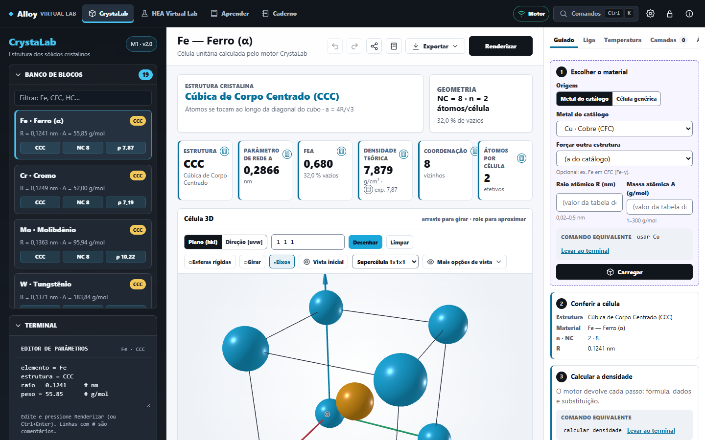 | 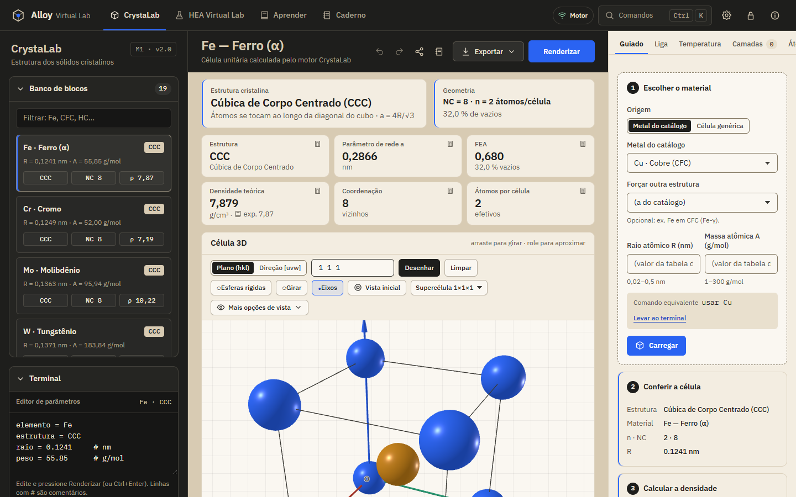 |
| 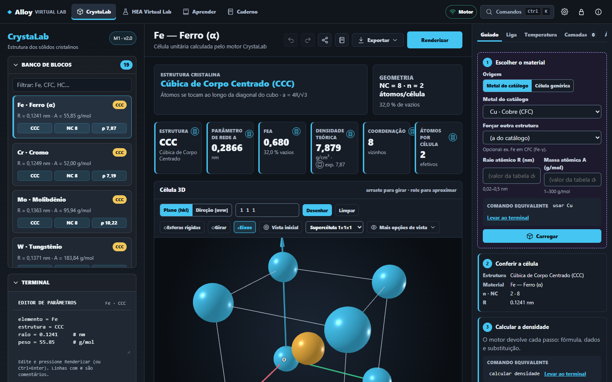 | 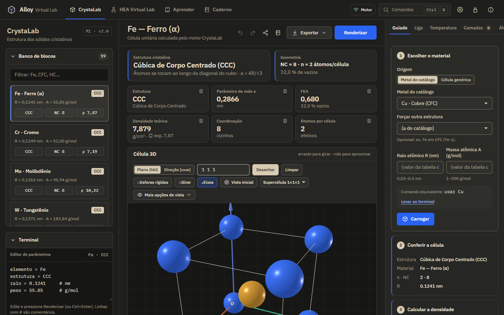 |
| 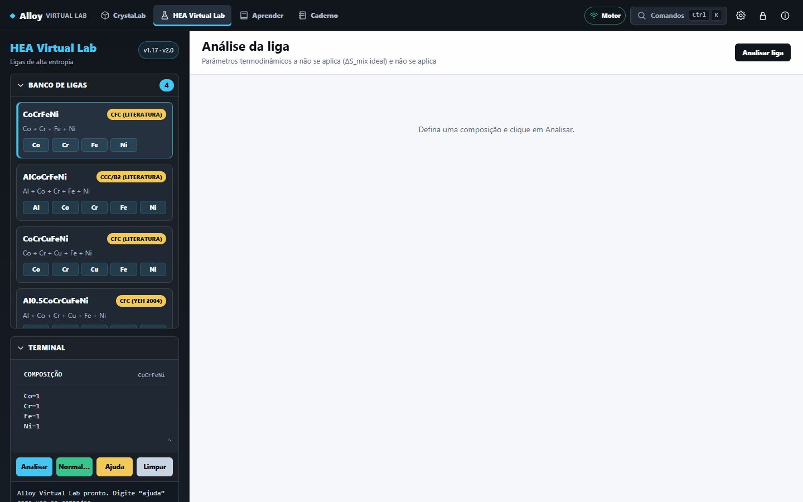 | 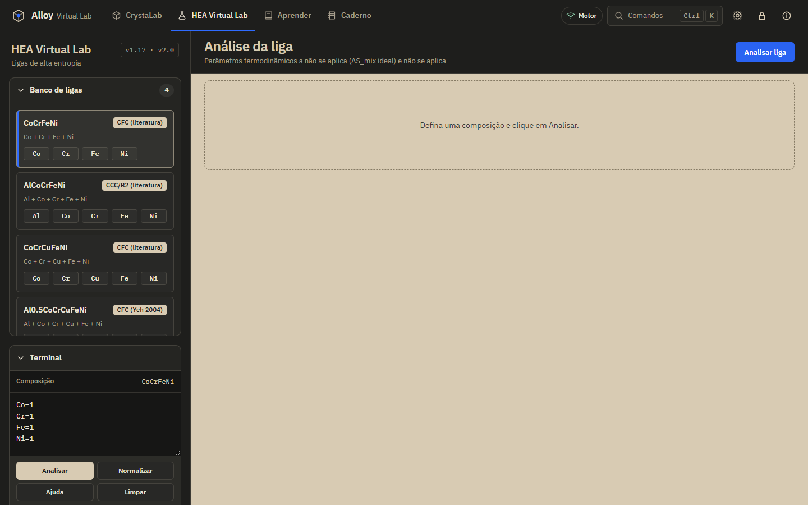 |
| 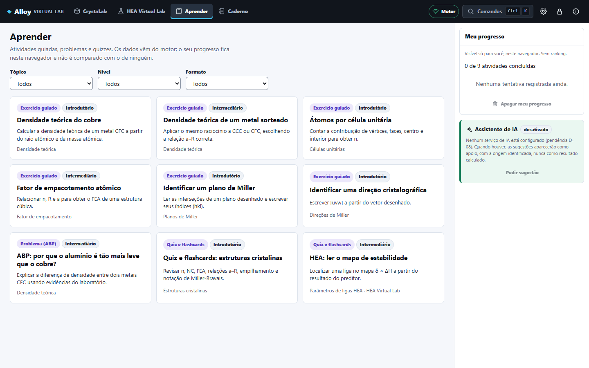 | 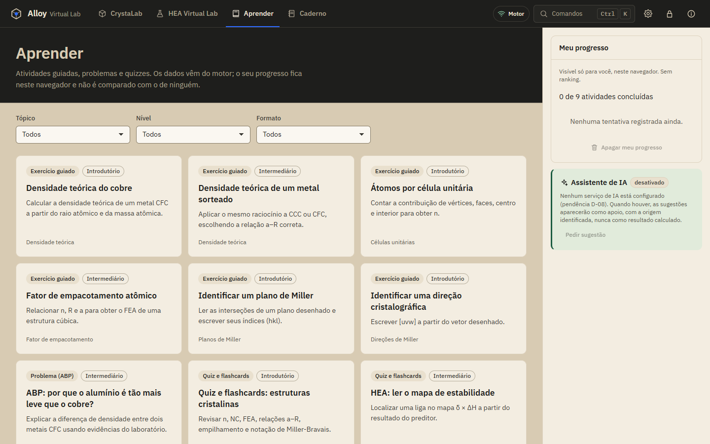 |
| 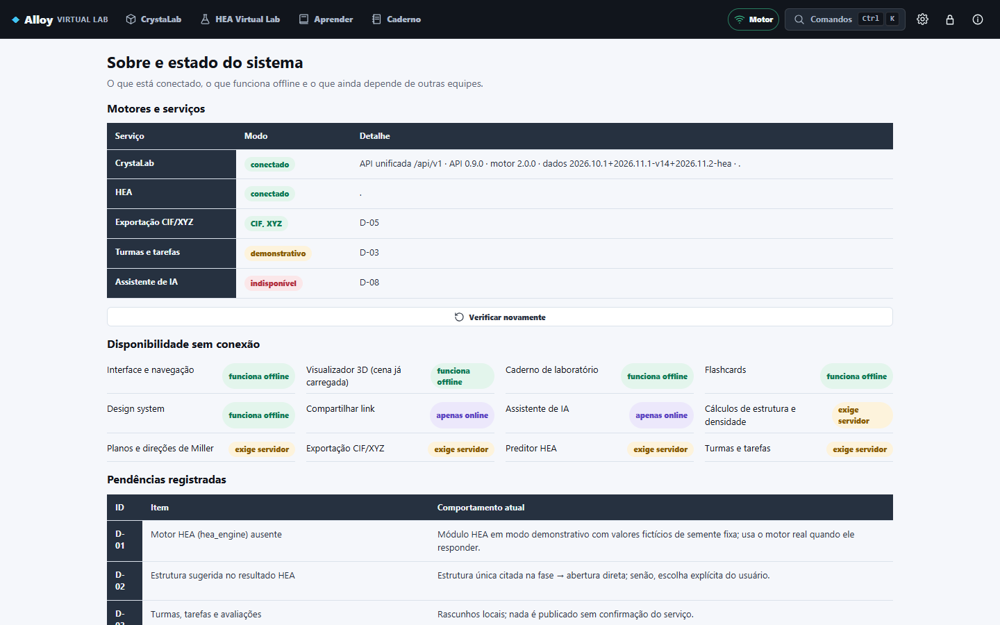 | 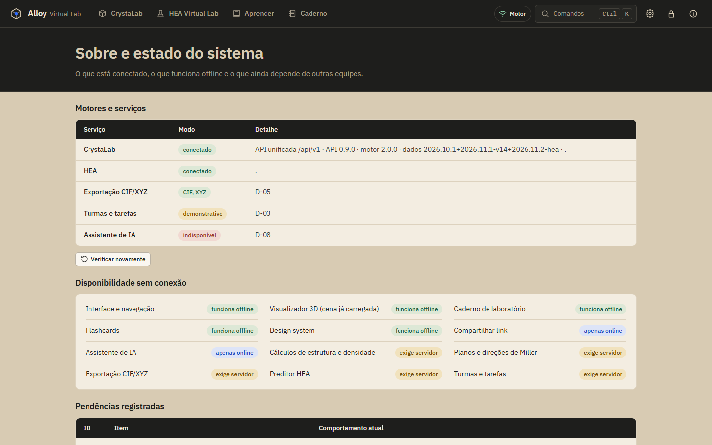 |
| 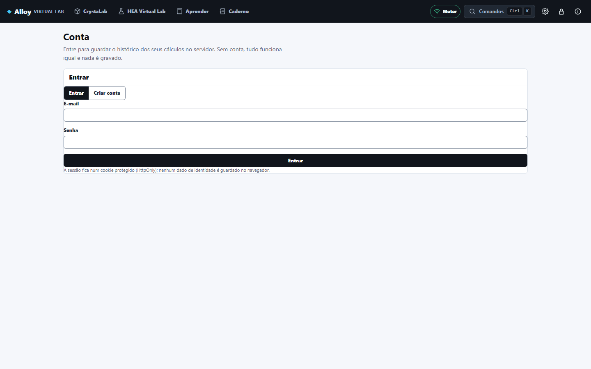 | 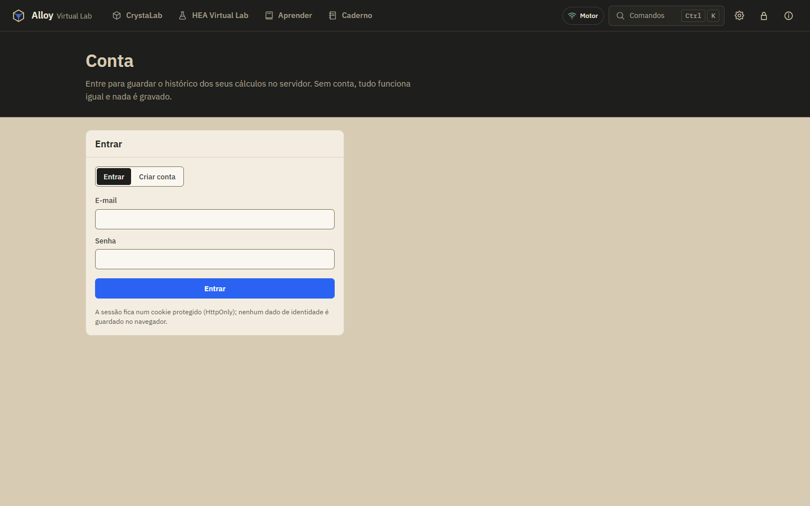 |
| 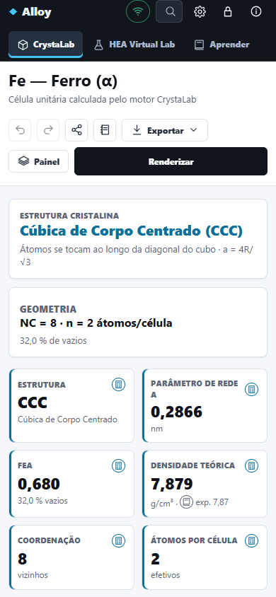 | 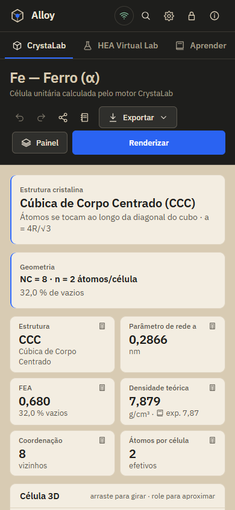 |

Outras telas depois da reforma: [resultado HEA](img/reforma-visual/depois-hea-resultado.png),
[exercício guiado](img/reforma-visual/depois-exercicio.png),
[tablet](img/reforma-visual/depois-tablet-crystalab.png).

## 6. Alterações técnicas

| Arquivo | Mudança |
|---|---|
| `src/design-system/tokens.css` | reescrito: paleta, escalas, tipografia, raios, tema claro e escuro, `.ds-on-dark` |
| `src/design-system/fonts.css` | **novo**: `@font-face` das fontes IBM Plex |
| `src/design-system/base.css`, `components.css` | reescritos sobre os tokens novos |
| `src/styles/app.css` | reescrito; todas as classes antigas mantidas |
| `src/styles/print.css` | faixas em carvão viram texto preto no papel |
| `src/main.tsx` | importa `fonts.css` |
| `src/app/App.tsx` | marca em SVG (célula de corpo centrado) no lugar do glifo "◆" |
| `AppShell.tsx`, `CrystaLabModule.tsx`, `HeaModule.tsx`, `AboutModule.tsx`, `AccountModule.tsx`, `CatalogModule.tsx`, `LearnModule.tsx`, `InstructorModule.tsx`, `NotebookModule.tsx` | só classes: `ds-on-dark` no cabeçalho e nas faixas de título; recuo nos painéis da Conta |
| `index.html`, `public/manifest.webmanifest`, `public/icons/*` | cor de tema e ícones na paleta nova |
| `tests/unit/i18n-tokens.test.ts` | 10 pares de contraste novos |
| `package.json`, `package-lock.json` | `@fontsource/ibm-plex-sans` e `@fontsource/ibm-plex-mono` 5.3.0 |
| `docs/DESIGN_SYSTEM.md`, `docs/FRONTEND.md`, `docs/HISTORICO_DE_ALTERACOES.md` | atualizados |

Nenhum arquivo removido. Nenhuma mudança em stores, comandos, serviços, contratos ou backend.

## 7. Testes executados

Rodados em 10/11/2026 no Windows 10, contra o backend real.

| Verificação | Resultado |
|---|---|
| `npm run typecheck` | sem erros |
| `npm run lint` (9 regras) | ok |
| `npm test` (unitários, com o contraste dos tokens) | 83 de 83 |
| `npm run build` e `npm run measure` | inicial 215,9 kB gzip (meta < 300 kB), Three.js fora do inicial; 101 arquivos no pré-cache |
| E2E (Playwright, 61 testes, 1366×900) | 60 passaram, 1 falhou |

O E2E rodou no Edge instalado (`channel: 'msedge'`), porque o Chromium do Playwright não está baixado
nesta máquina.

**A falha:** `perf-metrics.spec.ts` (FPS e latência de seleção, CFC 3×3×3). Depois dos 4 s de rotação
automática do teste, os átomos da célula-base ficam fora do quadro da câmera e o teste encontra 1 átomo
clicável, quando exige mais de 3. O ângulo final depende de quantos quadros a máquina desenha, e a
posição é medida em relação ao canvas, não à página. Não foi verificado se o teste já falhava nesta
máquina antes da reforma.

**O que a auditoria de acessibilidade pegou durante o trabalho** (corrigido): botão primário em hover no
tema escuro (4,05:1), texto de erro e botão de perigo direto sobre a areia (4,35:1) e etiqueta de
destaque (4,46:1). Os testes de seleção por clique também acusaram que a cena 3D tinha descido para
fora da primeira tela; a área acima do viewer foi compactada até a cena voltar a aparecer sem rolagem.

Conferência visual: capturas de todas as rotas em 1440×900 (claro e escuro), 820×1180 e 390×844, e dos
estados de diálogo, menu, foco, erro de campo, resultado de liga, temperatura e HEA.

## 8. Limitações

* O PDF de referências e as três referências externas não foram vistos (seção 2).
* O teste de desempenho do viewer falha nesta máquina (seção 7).
* Não testado em Firefox nem Safari. O layout usa container queries, `color-mix()` e `clip-path`,
  todos dentro dos alvos do build (Chrome 109, Firefox 115, Safari 16).
* O subtítulo do HEA sem resultado mostra "Parâmetros termodinâmicos a não se aplica (ΔS_mix ideal) e
  não se aplica". É texto, não visual, e já existia; ficou como estava.
* A barra de controles do viewer ocupa três linhas em telas de até 1.440 px de largura.
* IBM Plex Mono não tem grego; letras gregas no terminal usam a fonte monoespaçada do sistema.
