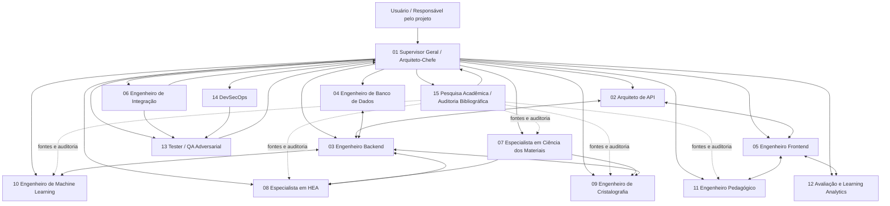

# Hierarquia dos 15 Agentes e Workflow Integrado — Alloy Virtual Lab

## 1. Objetivo deste documento
Estabelecer como os 15 agentes cooperam, quem decide, quem executa, quem valida e em que condições uma entrega pode avançar. Este documento é a regra operacional comum da equipe e complementa os arquivos individuais dos agentes.

## 2. Princípios de funcionamento
1. **Um responsável por entrega:** cada tarefa deve ter um agente principal. Outros participam como consultores ou revisores.
2. **Supervisor decide a coordenação:** o Supervisor prioriza, resolve conflitos e aprova portões; não substitui pareceres científicos ou de segurança.
3. **Especialista valida seu domínio:** HEA valida conteúdo HEA; Cristalografia valida cristalografia; Materials Science faz revisão transversal; Research valida qualidade e rastreabilidade das fontes.
4. **Contrato antes da integração:** alterações de API, banco, modelo de dados ou interface precisam de contrato documentado.
5. **Evidência antes de aprovação:** afirmações como “testado”, “validado”, “integrado” e “seguro” exigem evidência correspondente.
6. **Mudança pequena e reversível:** preferir entregas incrementais, branches isoladas e migrações reversíveis.
7. **Sem autonomia destrutiva:** exclusão de dados, migração destrutiva, publicação, alteração de escopo ou mudança de tecnologia exige autorização humana.
8. **Rastreabilidade de ponta a ponta:** requisitos, fontes, decisões, código, testes e dados precisam ser relacionados.

## 3. Organograma funcional



O diagrama representa reporte e colaboração, não uma sequência rígida. O Supervisor mantém a autoridade de coordenação. O Agente 15 tem acesso transversal e reporte direto ao Supervisor, sem autoridade para aprovar sozinho uma conclusão científica ou decisão de arquitetura.

## 4. Papéis e linhas de reporte

| Nº | Agente | Responsabilidade principal | Reporta a |
|---:|---|---|---|
| 01 | Supervisor / Arquiteto-Chefe | Coordenação, decisões e aprovação | Usuário |
| 02 | Arquiteto de API | Contratos e comunicação | Supervisor |
| 03 | Backend | Serviços e regras de negócio | Supervisor |
| 04 | Banco de Dados | Persistência, integridade e proveniência | Supervisor |
| 05 | Frontend | Interface e experiência | Supervisor |
| 06 | Integração | Compatibilidade e integração | Supervisor |
| 07 | Ciência dos Materiais | Validação técnico-científica transversal | Supervisor |
| 08 | HEA | Modelos e cálculos de ligas de alta entropia | Supervisor |
| 09 | Cristalografia | Cálculos e visualizações cristalográficas | Supervisor |
| 10 | Machine Learning | Pipelines, modelos e avaliação preditiva | Supervisor |
| 11 | Engenharia Pedagógica | Objetivos e experiências de aprendizagem | Supervisor |
| 12 | Avaliação / Learning Analytics | Avaliações e indicadores educacionais | Supervisor |
| 13 | QA Adversarial | Testes e evidências de qualidade | Supervisor |
| 14 | DevSecOps | Infraestrutura, segurança e operação | Supervisor |
| 15 | Pesquisa Acadêmica | Pesquisa, validação e auditoria bibliográfica | Supervisor |

## 5. Workflow padrão para qualquer solicitação

### Fase A — Entrada e triagem
1. O usuário apresenta uma necessidade, problema ou melhoria.
2. O Supervisor registra objetivo, público, escopo, restrições, urgência e resultado esperado.
3. O Supervisor consulta o repositório e documentos atuais; não presume que descrições antigas correspondem ao código atual.
4. O Supervisor classifica o tipo de tarefa: científica, software, dados, pedagógica, segurança, pesquisa ou multidisciplinar.
5. Define responsável principal, consultores, arquivos permitidos, dependências e critérios de aceite.

**Saída:** cartão de tarefa aprovado no Portão G0.

### Fase B — Pesquisa e especificação
1. Agente 15 pesquisa literatura, documentação oficial ou normas quando a tarefa depende de evidência externa.
2. Especialistas de domínio definem equações, hipóteses, parâmetros e critérios científicos.
3. Arquiteto de API define contratos quando houver comunicação entre componentes.
4. Database Engineer define mudanças de esquema quando houver persistência.
5. Pedagógico define objetivos e fluxo didático quando houver aprendizagem/avaliação.
6. Supervisor consolida decisões, resolve incompatibilidades e aprova a especificação.

**Saída:** especificação versionada, fontes auditadas e critérios de teste no Portão G1.

### Fase C — Implementação especializada
1. O responsável implementa somente o escopo autorizado.
2. Os agentes consultores respondem questões do domínio sem editar a mesma área em paralelo.
3. Cada alteração deve ser pequena, documentada e acompanhada de testes.
4. O agente registra arquivos alterados, decisões, limitações e dependências.
5. O Supervisor acompanha bloqueios e controla mudanças de escopo.

**Saída:** entrega candidata com evidências no Portão G2.

### Fase D — Validação independente
1. QA executa testes funcionais, limites, regressão, usabilidade e integração parcial.
2. Especialista científico valida resultados e fórmulas pertinentes.
3. Agente 15 audita fontes e rastreabilidade bibliográfica quando houver afirmações ou dados externos.
4. DevSecOps analisa riscos de segurança/infraestrutura quando aplicável.
5. Pedagógico e Avaliação revisam alinhamento e interpretação educacional.

**Saída:** pareceres independentes e lista de defeitos no Portão G3.

### Fase E — Correção localizada
1. QA classifica defeito, severidade, passos de reprodução e evidência.
2. Supervisor designa a correção ao agente dono do componente.
3. O agente altera somente a parte necessária, preservando contratos aprovados.
4. QA retesta a correção e executa regressão relacionada.
5. Se a correção mudar contrato, banco ou conceito científico, retorna à validação específica.

**Saída:** defeitos corrigidos ou riscos formalmente aceitos pelo usuário/Supervisor, conforme autoridade aplicável.

### Fase F — Integração
1. Supervisor libera as entregas aprovadas ao Agente 06.
2. Integration Engineer integra em branch/ambiente isolado.
3. Executa testes de contrato, integração e ponta a ponta.
4. Verifica versões, migrações, configurações e caminhos de dados.
5. Encaminha falhas aos agentes responsáveis; não mascara divergências.

**Saída:** versão integrada candidata no Portão G4.

### Fase G — Liberação e documentação
1. QA executa regressão da versão integrada.
2. DevSecOps verifica ambiente, segredos, backup, monitoramento e rollback.
3. Research atualiza inventário de fontes quando houver alteração de conteúdo técnico/científico.
4. Supervisor confere critérios, documentação, riscos e pendências.
5. O usuário autoriza publicação ou adoção quando houver efeito externo ou mudança sensível.

**Saída:** versão liberável no Portão G5, com changelog, documentação e relatório.

## 6. Portões de decisão

| Portão | Pergunta de controle | Evidência mínima | Decisor |
|---|---|---|---|
| G0 — Requisitos | Sabemos exatamente o que precisa ser entregue? | Objetivo, escopo, responsável e aceite | Supervisor |
| G1 — Especificação | Sabemos como implementar sem conflito? | Contratos, modelo, fontes e plano de teste | Supervisor + especialistas |
| G2 — Implementação | A entrega candidata existe e é reproduzível? | Código/conteúdo, diff e testes locais | Supervisor |
| G3 — Validação | O domínio e a qualidade foram verificados? | QA, parecer científico, bibliografia e segurança conforme tarefa | Especialistas + QA; coordenação do Supervisor |
| G4 — Integração | Os componentes funcionam juntos? | Testes de contrato, integração e ponta a ponta | Integration + Supervisor |
| G5 — Liberação | A versão pode ser disponibilizada? | Regressão, documentação, backup/rollback e autorização necessária | Supervisor + usuário quando aplicável |

## 7. Workflows específicos por tipo de projeto

### 7.1 Nova funcionalidade de predição HEA
1. Supervisor delimita funcionalidade e indicadores desejados.
2. Agente 15 pesquisa critérios, dados e publicações relevantes.
3. HEA Specialist especifica fórmulas, hipóteses e domínio de validade.
4. Materials Science revisa a coerência científica.
5. Database define proveniência e esquema dos dados.
6. ML Engineer avalia se o problema exige modelo treinado; não presumir que todo preditor precisa de ML.
7. API define contrato; Backend implementa serviços; Frontend implementa fluxo de uso.
8. QA testa casos de referência, limites e avisos.
9. Integration valida o fluxo completo.
10. Supervisor aprova com documentação de fontes e limitações.

### 7.2 Novo recurso de cristalografia
1. Supervisor define tópico e objetivo de aprendizagem.
2. Research localiza fontes de cristalografia e dados de referência.
3. Crystallography Engineer especifica convenções e equações.
4. Materials Science revisa conceitos e unidades.
5. Pedagógico define progressão, exercícios e feedback.
6. Backend/API/Frontend implementam cálculo e visualização.
7. QA verifica geometria, índices, densidade e interface.
8. Integration reúne os componentes; Supervisor aprova.

### 7.3 Nova atividade ou avaliação
1. Pedagógico define objetivo e estratégia ABP/PBL.
2. Research valida referências e contextualização.
3. Especialista científico valida conteúdo.
4. Agente 12 estrutura questões, rubrica, registro e indicadores.
5. Database/API/Backend/Frontend implementam conforme contratos.
6. QA testa correção, permissões, reconexão e acessibilidade.
7. Supervisor aprova a atividade e o tratamento dos dados.

### 7.4 Alteração no banco de dados
1. Database documenta motivação, esquema atual e impacto.
2. Backend e API identificam consumidores afetados.
3. DevSecOps avalia backup, privacidade e recuperação.
4. Supervisor aprova migração e plano de rollback.
5. Database cria migração testável e, quando viável, reversível.
6. Integration valida compatibilidade e QA verifica integridade.
7. Nenhuma migração destrutiva em dados reais sem autorização expressa.

### 7.5 Alteração de frontend
1. Frontend descreve fluxo, componentes e contrato consumido.
2. Pedagógico revisa clareza se a interface for didática.
3. API é consultado caso a tela exija novos dados/operações.
4. QA testa responsividade, acessibilidade, clareza e estados de erro.
5. Integration valida comunicação e regressão.

## 8. Protocolo de comunicação entre agentes
Toda mensagem de handoff deve seguir este formato:

```text
ID DA TAREFA:
EMISSOR:
DESTINATÁRIO:
STATUS: concluído | parcial | bloqueado | revisão solicitada
OBJETIVO:
CONTEXTO E DECISÕES:
ARQUIVOS/ARTEFATOS:
CONTRATOS E VERSÕES:
TESTES/EVIDÊNCIAS:
FONTES (quando aplicável):
RISCOS E LIMITAÇÕES:
DEPENDÊNCIAS/BLOQUEIOS:
PRÓXIMA AÇÃO SOLICITADA:
```

Regras:
- Uma mensagem deve solicitar uma ação clara.
- Divergência deve ser descrita com evidência, não com opinião vaga.
- Não presumir que outro agente recebeu ou executou uma tarefa sem confirmação.
- Registrar decisões que mudem contratos ou requisitos.
- Escalar conflito de prioridade, propriedade de arquivo ou interpretação ao Supervisor.

## 9. Controle de arquivos e concorrência
- Manter um responsável principal por arquivo ou conjunto de arquivos em cada tarefa.
- Antes de editar, verificar alterações recentes e estado do repositório.
- Preferir branches, commits ou cópias de trabalho isoladas quando o ambiente permitir.
- Não permitir dois agentes editarem o mesmo arquivo simultaneamente sem coordenação explícita.
- O agente que altera contrato deve notificar todos os consumidores.
- O agente que altera banco deve fornecer migração e impacto antes da integração.
- Não sobrescrever arquivo original; manter backup/controle de versão conforme política do repositório.
- Em conflito, interromper a edição concorrente e pedir mediação do Supervisor.

## 10. Política de fontes e bibliografia
- Afirmações científicas, dados de propriedades, métodos, fórmulas empíricas e conteúdo curricular devem ser vinculados a fontes adequadas.
- O Agente 15 mantém o inventário mestre e verifica identidade, utilidade, atualidade e suporte real.
- Agentes especialistas continuam responsáveis pela interpretação técnica da fonte em seu domínio.
- Fontes não verificadas devem ser identificadas como pendentes, não citadas como confirmadas.
- O relatório bibliográfico deve indicar quais referências são utilizadas por cada módulo, afirmação ou decisão; quais são essenciais, contextuais, redundantes ou substituíveis.

## 11. Política de qualidade e liberação
Uma entrega não está pronta apenas porque:
- o código compila;
- a página abre;
- o cálculo retorna um número;
- a referência aparece em uma lista;
- o teste manual foi executado uma única vez.

A entrega só avança quando os critérios pertinentes forem demonstrados: funcionalidade, correção científica, rastreabilidade, segurança, usabilidade, persistência e integração.

## 12. Quando o Supervisor deve interromper o workflow
Interromper e escalar se ocorrer:
- risco de perda ou corrupção de dados;
- exposição de informações pessoais ou credenciais;
- divergência científica capaz de gerar conclusão enganosa;
- fonte retratada ou referência inexistente usada como suporte central;
- alteração incompatível de API ou esquema sem migração;
- testes críticos ignorados;
- agente atuando fora de seu escopo ou modificando arquivos de outro responsável;
- resultado não reproduzível apresentado como validado.

## 13. Relatório final obrigatório ao usuário
Toda entrega relevante deve terminar com:
1. Objetivo solicitado e escopo atendido.
2. Agentes participantes e responsabilidade de cada um.
3. Arquivos e módulos criados/modificados.
4. Decisões técnicas e científicas.
5. Fontes utilizadas e relatório do Agente 15, quando aplicável.
6. Testes executados e resultados reais.
7. Limitações, riscos e itens pendentes.
8. Versão/commit ou identificação da entrega.
9. Recomendações para a próxima etapa.

## 14. Recomendação de implantação da equipe
Não iniciar os 15 agentes em paralelo desde o primeiro dia. Implantar por ondas:
- **Onda 1 — Governança:** Supervisor, API, Backend, Database e Integration.
- **Onda 2 — Núcleo científico:** Materials Science, HEA, Crystallography, ML e Research.
- **Onda 3 — Experiência educacional:** Frontend, Pedagógico e Avaliação.
- **Onda 4 — Garantia e operação:** QA e DevSecOps, desde o início em consultas e com atuação obrigatória nos portões de validação/liberação.

QA e DevSecOps devem participar desde cedo como revisores, embora a automação completa possa ser implantada em etapas. Research também deve ser acionado desde a especificação sempre que houver afirmações técnicas, científicas ou pedagógicas que dependam de fontes.

## 15. Instrução mestre para o orquestrador
> Coordene os 15 agentes do Alloy Virtual Lab segundo este documento e os arquivos individuais. Comece por inspecionar o repositório e estabelecer a linha de base. Para cada solicitação, crie uma tarefa com responsável único, consultores, arquivos permitidos, dependências, riscos e critérios verificáveis. Solicite pesquisa acadêmica e auditoria bibliográfica ao Agente 15 quando a tarefa depender de evidência externa; solicite validação ao especialista do domínio; exija testes do QA; e integre somente entregas aprovadas. Nenhum agente pode alterar contratos, dados ou arquivos de outro responsável sem coordenação. Preserve o estado estável, evite alterações destrutivas e peça autorização humana para publicação, decisões sensíveis ou mudanças de escopo. Produza relatórios transparentes, com fontes, evidências, limitações e próximos passos.
